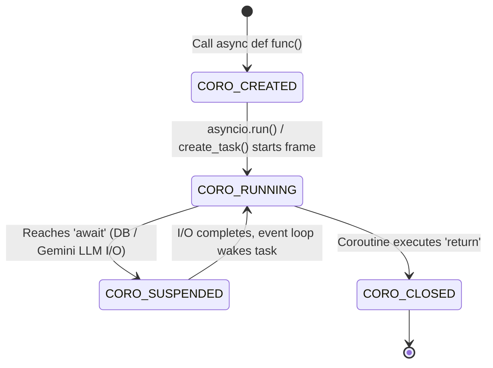

# Module 04: Python Coroutines (Generators to Native `async def`)

## 📌 Executive Summary
This module traces the evolution of coroutines in Python—from generator-based bidirectional data pipelines (`yield` / `.send()`) to modern native coroutines (`async def`). We examine how native coroutines operate with **lazy evaluation** and track the 4 internal CPython coroutine lifecycle states while performing real-world **SQLite database queries** and **Google Gemini LLM calls**.

> **Note for Users & GitHub Visitors:**  
> If an LLM subscription or API key is not available, the user can use `asyncio.sleep()` to execute code. All scripts include automatic, graceful fallbacks to sleep simulation so the code runs seamlessly in any environment.

---

## 📖 Theoretical Deep Dive

### 1. The 4 CPython Coroutine Lifecycle States
A Python native coroutine transitions through 4 deterministic states tracked via `inspect.getcoroutinestate()`:



1. **`CORO_CREATED`**: The coroutine object is instantiated in memory, but execution has not entered its frame (Lazy evaluation).
2. **`CORO_RUNNING`**: The coroutine frame is currently active on the Python call stack.
3. **`CORO_SUSPENDED`**: The coroutine hit an `await` expression (e.g. waiting for SQLite disk read or Gemini API network packets) and yielded control to the event loop.
4. **`CORO_CLOSED`**: The coroutine returned its final result and its execution frame was terminated.

---

### 2. Lazy Evaluation Mechanics
In `02_native_coroutines.py`:
- Calling `coro = fetch_user_and_generate_ai_greeting(1)` does **NOT** query SQLite and does **NOT** call Gemini.
- It returns a dormant `<coroutine object>` in `CORO_CREATED` state.
- Code only runs when bound to an event loop via `asyncio.run(coro)` or `await coro`.

---

## 💻 Script-by-Script Breakdown

| Script | Real-World Workload | Key Learning Point |
|---|---|---|
| `01_generator_to_coroutine.py` | Prompt construction pipeline using `.send()` | Demonstrates generator frame pausing, bidirectional parameter passing, and `StopIteration.value`. |
| `02_native_coroutines.py` | SQLite user lookup + Gemini greeting | Proves lazy evaluation: `async def` does nothing until explicitly executed by the event loop. |
| `03_coroutine_states.py` | Async DB + Gemini LLM pipeline | Inspects live state transitions: `CORO_CREATED` $\to$ `CORO_SUSPENDED` $\to$ `CORO_CLOSED`. |

---

## 🏃 Expected Console Outputs

### Running `02_native_coroutines.py`:
```text
=================================================================
  MODULE 04: NATIVE COROUTINES & LAZY EVALUATION (REAL I/O)
=================================================================
Step 1: Invoking 'fetch_user_and_generate_ai_greeting(1)'...
  -> Type of returned object : <class 'coroutine'>
  -> Is it a coroutine object?: True
  -> NOTICE: No database or Gemini calls happened yet.

Step 2: Now executing coroutine object with asyncio.run(coro_obj)...
  [Coro Body] >>> Coroutine execution STARTED for User #1!
  [Coro Body] Querying ecommerce.db...
  [Coro Body] Retrieved user: Alice Johnson (admin)
  [Coro Body] Calling Google Gemini API for personalized greeting...

---------------- Final Returned Result ----------------
  We are absolutely delighted to extend a warm welcome to Alice Johnson, our esteemed administrator.
```

### Running `03_coroutine_states.py`:
```text
=================================================================
  MODULE 04: TRACKING COROUTINE LIFECYCLE STATES (REAL I/O)
=================================================================
1. Initial State (Created, unstarted) : CORO_CREATED
  [Coro Body] >>> Step 1: Querying SQLite database...
2. Suspended State (Awaiting I/O)    : CORO_SUSPENDED
   Notice: The coroutine yielded control and is paused waiting for I/O!
  [Coro Body] >>> Step 2: Awaiting Gemini LLM response for Bob Smith...
3. Final State (Completed / Closed)  : CORO_CLOSED

Pipeline Return Value: 'Hello, Bob Smith, customer!'
```

---

## ❓ Exercises & Knowledge Checks

1. **Question**: What state is a coroutine in when it is paused waiting for `client.aio.models.generate_content()`?
   - *Answer*: `CORO_SUSPENDED`.

2. **Practice Task**: If an LLM subscription or API key is not set, verify how `02_native_coroutines.py` and `03_coroutine_states.py` fall back to `asyncio.sleep()` cleanly.
